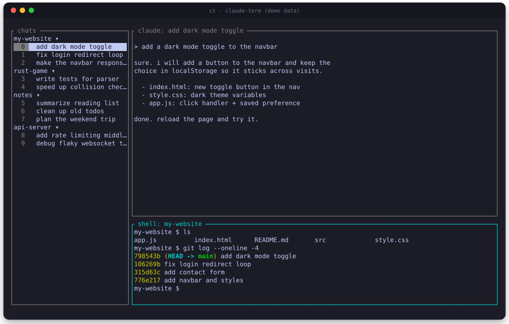
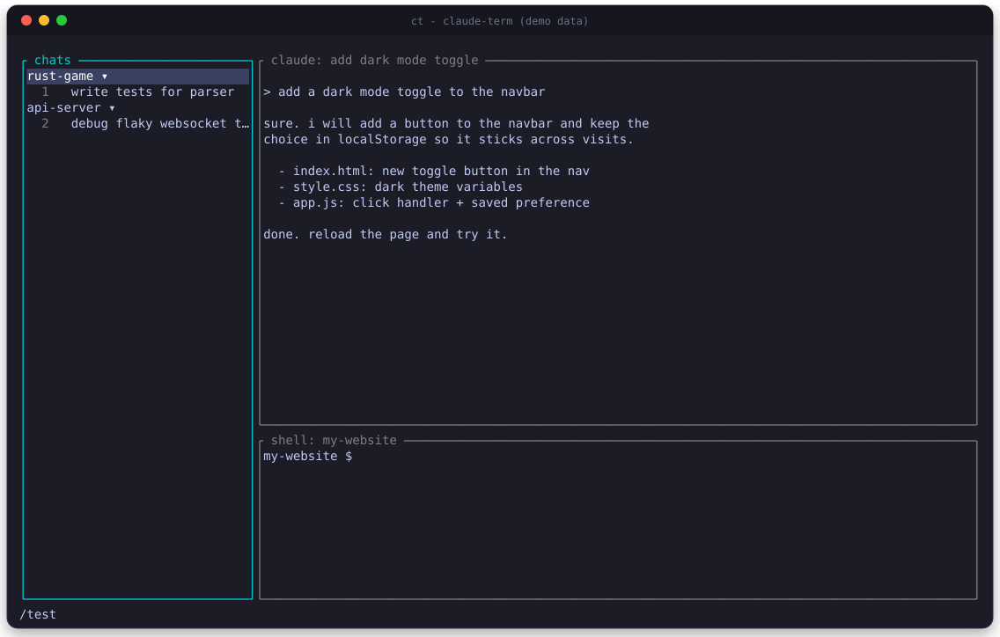
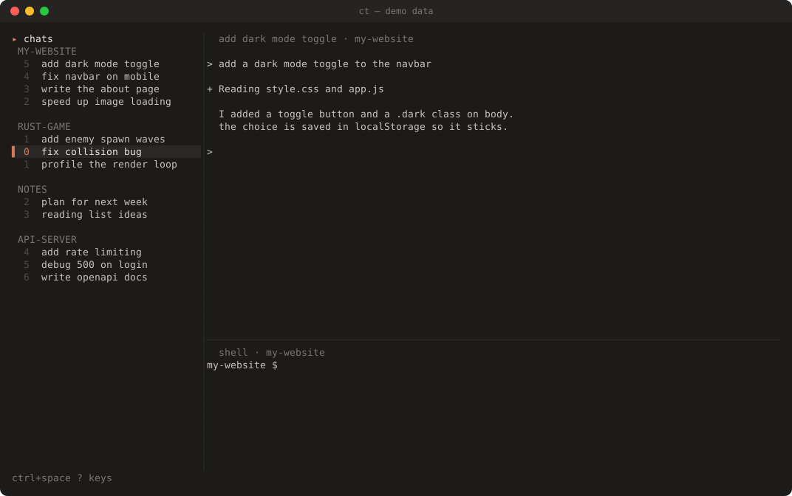

# ct

a vim-style terminal app for claude code chats. your history in a sidebar, a live `claude` pane and a shell, all in one terminal.



*screenshots use demo data.*

## why

the claude desktop app is nice, but i wanted to live in one terminal. `ct` lists every chat from `~/.claude/projects`, grouped by folder, and lets you jump between them with vim keys. pick one and it resumes in an embedded claude pane, with a shell for that folder right under it. no window switching, no extra api key: it uses your normal claude code login.

## features

- sidebar of all your chats, grouped by folder, with live updates as sessions change
- vim motions: `j`/`k`, counts (`3j`), `gg`/`G`, `{`/`}` between folders, `/` to filter
- relative numbers and `alt+1..9` to jump to a chat in one keystroke
- a real `claude` pane and a shell pane per chat, kept running in the background
- activity dots that show which chats are printing or have something new to read
- scrollback, zoom, mouse support and a tmux-style prefix key
- opens the chat you had last, and asks before opening the same chat twice (fork instead)

## requirements

- macOS (linux likely works but is untested)
- [rust](https://rustup.rs) to build it
- [claude code](https://claude.com/claude-code) installed and logged in, with `claude` on your PATH

## install

```
cargo install --git https://github.com/Par-python/claude-term
```

or from source:

```
git clone https://github.com/Par-python/claude-term
cd claude-term
cargo install --path .
```

## usage

```
ct
```

`ct --dump` prints how many sessions it found and the first few, handy to check it sees your chats.

## keys

sidebar (when it has focus):

| key | does |
| --- | --- |
| `j` / `k` (or arrows) | move down / up through chats. a count works: `3j` |
| `{` / `}` | previous / next folder (counts work) |
| `gg` / `G` | top / bottom |
| `enter` | on a chat: open it. on a folder: collapse / expand |
| `n` | new chat in the current folder |
| `N` | new folder (type a path, enter) |
| `/` | filter chats (enter to keep it, esc clears) |
| `esc` | clear the filter |



the number next to each chat is how far it is from the cursor, so `5j` or `alt+5` always lands where you expect.



everywhere:

| key | does |
| --- | --- |
| `alt+1..9` | jump that many chats down and open it |
| `alt+shift+1..9` | same, going up |
| prefix, then `h` `j` `k` `l` | move focus between sidebar, claude and shell |
| prefix, then `z` | zoom the focused pane |
| prefix, then `b` | show / hide the sidebar |
| prefix, then `[` | scroll mode on the focused pane (see below) |
| prefix, then `q` | quit (closes every child process) |

when you open a chat that is already open in another claude, ct asks first: `f` opens a copy (a fork), `esc` cancels.

the dots next to a chat only show for chats ct started. `●` (green) means it is printing output right now. `•` (yellow) means it printed while you were looking at another chat and has gone quiet since, so there is something new to read. focusing the chat clears it.

the prefix is `ctrl+space` by default. it can also be `ctrl+a` ... `ctrl+z`, except `ctrl+h`, `ctrl+i`, `ctrl+j` and `ctrl+m` (and `ctrl+[`): terminals send those as backspace, tab, newline, enter and esc, so ct can't tell them from the plain keys. ct ignores those and uses `ctrl+space` instead. every other key goes straight to claude or the shell when that pane has focus. when a pane's process has exited, press `enter` in it to restart.

## scrolling and the mouse

ct captures the mouse by default, so the wheel scrolls whatever is under it:

- over the claude or shell pane: scrolls back through that pane's history (3 lines per notch). if the program in the pane turned on its own mouse mode, the wheel goes to the program instead.
- over the sidebar: moves the cursor.
- left click on a pane focuses it. left click on a chat in the sidebar opens it.

scroll mode (prefix, then `[`) is the keyboard way to scroll the focused pane:

| key | does |
| --- | --- |
| `k` / `j` | one line back / forward |
| `ctrl+u` / `ctrl+d` | half a page back / forward |
| `g` / `G` | oldest / newest |
| `q` or `esc` | leave and jump to the bottom |

the status line shows `scroll: N lines up` while you are scrolled back. typing into a pane jumps it back to the bottom.

because the mouse is captured, your terminal's own text selection is off. hold `shift` (or `option` in some macOS terminals) while dragging to select text natively. set `mouse = false` in the config to give the mouse back to the terminal completely (then no wheel scrolling or clicks, use scroll mode).

on macOS, alt+number from inside a pane needs your terminal's "option as meta" (or "option as alt") setting turned on. without it the sidebar still works, because ct also understands the symbols option+number types (like `£` for 3).

## config

optional file: `~/.config/claude-term/config.toml`. every key, with its default:

```toml
max_background = 5          # how many chats can keep running in the background
prefix = "ctrl+space"       # or "ctrl+a" ... "ctrl+z"
jump_modifier = "alt"       # only "alt" is supported for now
mac_option_symbols = true   # accept option+number symbols (£ etc) as jumps in the sidebar
mouse = true                # capture the mouse for wheel scrolling and clicks (shift+drag selects text)
```

a missing or invalid file just means defaults.

## how it works

ct reads `~/.claude/projects` read-only to build the sidebar and never writes to it. opening a chat runs `claude --resume <id>` in a pty inside ct, next to a shell in the chat's folder. ct keeps its own small state (last chat) in `~/.config/claude-term/`.

## disclaimer

this is an unofficial community project. it is not affiliated with, endorsed by, or supported by anthropic. "claude" is a trademark of anthropic.

## license

mit, see [LICENSE](LICENSE).
